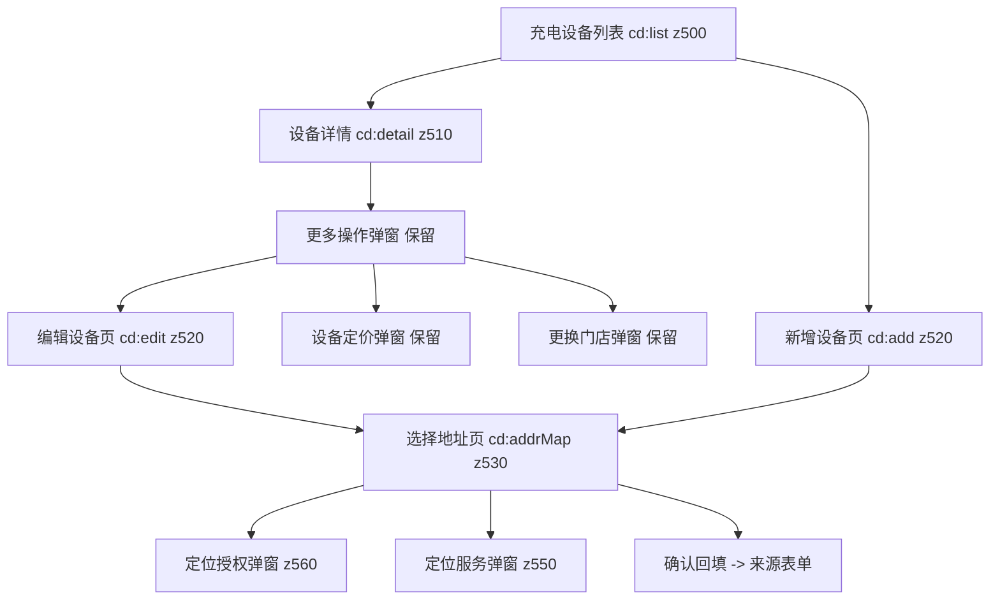

## 需求概述

把商户端「充电设备」的地址选择交互改为与换电端（swap.html）**完全一致**；并按澄清结论把**「编辑设备」表单从弹窗改为页面**（「设备定价」保持弹窗，「更换门店」同样保持弹窗）。

## 核心功能

- **编辑设备表单改页面**：「编辑设备」从底部弹窗改为独立全屏页面（与「新增设备」页同范式：导航栏标题 + 可滚动表单区 + 底部毛玻璃保存按钮），字段、校验、权限判断与保存结果保持不变。**「设备定价」保持现有底部弹窗**（用户明确要求）；「更换门店」不含地址字段、非本次诉求，同样保持现有弹窗。
- **选择地址改为独立页面**：新增设备页与编辑设备页的地址字段右侧地图入口，统一打开同一个「选择地址」页面（不是弹窗）。
- **地图拖拽取点**：可拖拽的假地图（世界层随手指平移、边界受限），松手后自动吸附最近的候选地址并平滑归位；中心固定橙色准星指示落点。
- **候选地址**：地图上以绿点 + 名称气泡展示候选点，选中态变橙色并放大；页面底部为候选地址列表（名称/详细地址/距离），点击即选中并使地图居中。
- **当前定位**：地图右下角圆形定位按钮，触发「定位授权（App 级）→ 定位服务（系统级）」两步确认弹窗，两步就绪后自动取定位点并居中。
- **确认与取消**：底部「确认」按钮回填地址到来源表单并关闭页面；未选点直接确认时提示「请在地图上选择地址」；导航栏返回即放弃本次选择，回到原表单页。
- **地址输入联想对齐**：地址输入框的联想下拉在「已精确命中某个候选地址」时不再弹出，点选联想项回填**完整地址**。

## 视觉与交互效果

- 视觉数值、布局比例、动效节奏与换电端选点页逐项一致：浅绿灰地图底、白色半透明路网与路名、白底灰字候选气泡、橙色选中点、居中橙色准星、右下白色圆角定位按钮、底部白色候选列表 + 主色确认按钮。
- 交互手感一致：拖动跟手不卡顿、松手吸附并带约 0.35s 缓动归位、拖动过程中不实时吸附、列表点选立即居中、定位按钮在未授权时先弹授权而不是直接取值。
- 「新增设备」页与新的「编辑设备」页视觉一致（同样的导航栏、表单行、底部保存按钮）。

## 技术栈

- 页面形态：单文件 `index.html`（无构建步骤），Vue 3 全局构建（CDN）、UnoCSS runtime、lucide 0.344.0 图标；商户端挂在 `#root-merchant`，样式写在 `<style id="layer-merchant">`（246-299 行）作用域内。
- 参考实现（只读基准）：`swap.html`（换电端），其「选择地址」页与样式是本轮的唯一对齐标准。
- 自检脚本：`scripts/i18n_check.mjs`（两目录五语键一致性）；验证用 Playwright MCP。
- 结论：沿用现有技术栈，不引入任何新库/新构建。

## 实现方案

整体策略是「**1:1 移植换电端选点页 + 编辑设备表单弹窗改页面（复用本仓库既有页面范式）**」，不做任何新设计。

### 1. 编辑设备表单：弹窗 → 独立页面（复用既有页面范式）

现状：`编辑设备/设备定价` 共用一个 `<bottom-sheet :open="cdMod==='edit'||cdMod==='price'" :mask-z="800">`（约 4981-5014 行）；`更换门店` 是另一个 `<bottom-sheet :open="cdMod==='shop'" :mask-z="800">`（约 5027-5038 行）。

改造后：

- **编辑设备** → 独立 `<page>`，状态由 `cdOV` 驱动（扩展现有枚举 `'' | 'list' | 'detail' | 'add'` → 增加 `'edit' | 'addrMap'`），完全照搬「新增设备」页结构：`nav-bar(title, @back="goBack()")` + `flex-1 overflow-y-auto min-h-0 conf-scroll-hide px-4 pt-4 pb-[112px]` 表单区 + `absolute bottom-0 left-0 right-0 px-5 pb-7 pt-3 z-[10]`（`background:rgba(246,247,249,.95);backdrop-filter:blur(10px)`）保存按钮。字段（设备编号、设备地址）从弹窗搬到页面时，`ff-box-gray`（弹窗灰底）改回 `ff-box`（页面白底），与「新增设备」页一致。
- **设备定价（price）保持原 `bottom-sheet` 不动**：`cdMod==='price'` 分支、`cdSavePrice()`、`cd-mod-submit` 均保留；对应地，`cdMod` 状态继续保留（供 price/shop 使用），只是 edit 分支改走 `cdOV`。
- **更换门店（shop）保持原 `bottom-sheet` 不动**：`cdMod==='shop'`、`cdSaveShop()`、`cd-shop-submit` 保持。

关键决策：**编辑设备的状态从 `cdMod` 迁移到 `cdOV`**（price/shop 仍用 `cdMod`）。理由是 `cdOV` 已在页面栈的 `nameOf` 中注册（`if(cdOV.value)return 'cd:'+cdOV.value;`，约 10330 行），`navOpen()/navBack()` 的快照机制会自动记录并还原 `cdOV`，因此新页面天然获得「返回栈 + 滑动返回（`swipe-close`）+ 快照回滚」能力；而 `cdMod` 是纯弹窗状态，不参与页面栈。

- `cdOpenMod(kind)`：`kind==='edit'` 时改为 `cdOV.value='edit'`（保持先 `navOpen()` 再赋值，快照才会记录赋值前的状态）；`kind==='price'|'shop'` 仍走 `cdMod.value=kind`。保留函数名以缩小改动面。
- 编辑设备保存成功后由 `cdCloseMod()` 改为「回退一层 + 回到详情页」（`navDrop(); cdOV.value='detail'`），与既有 `cdSaveAdd()` 的 `navDrop();cdOV.value='list'` 写法同构。
- 连带需要更新：权限面板映射（约 8490-8492 行的 `if(cdOV.value==='list'|'detail'|'add')` 分支需补 `edit`/`addrMap` 的标题与权限组）；`cdOV` 的注释枚举（约 10063 行）；模块头注释（约 10046-10050 行）。页面路径 `'/charge-devices/'+cdOV.value`（约 8582 行）已是通用写法，无需改。

### 2. 「选择地址」页（与 swap.html 逐项一致）

- **样式**：把 swap.html 的 `.sm-world/.sm-road-h/.sm-road-v/.sm-roadlbl/.sm-poi(/ .pdot / .pnm / .on .pdot)/.sm-loc-btn`（swap.html 63-73 行）数值原样搬入 `<style id="layer-merchant">`，类名改为 `#root-merchant .cdsm-*` 前缀作用域。已确认 `index.html` 内不存在 `.sm-*` 类名冲突（grep 0 命中）。
- **DOM**：新增 `<page :open="cdOV==='addrMap'" :z="530" oid="mc-charge-device-addr-map-page">`，结构照搬 swap.html 2676-2719 行：
- `nav-bar` 标题「选择地址」+ `@back` 取消返回；
- 地图容器 `class="flex-1 min-h-0 relative overflow-hidden select-none" style="background:#EAEFE7;touch-action:none"` + `@pointerdown/@pointermove/@pointerup/@pointercancel`；
- 世界层 `class="cdsm-world" :style="cdMapWorldStyle"`：4 条横路（`top:12%/38%/64%/88%`）、4 条纵路（`left:14%/36%/58%/80%`）、4 个路名（黄河中路 / 航空港街道 / 西航港大道 / 双流西站广场）、候选点 `v-for`（`:class="cdMapDraft===p.addr?'on':''"`、`:style="{left:p.lx+'%',top:p.ly+'%'}"`，内含 `.pdot` + `.pnm`）；
- 居中准星（`w-9 h-9` 圆 + `background:#FF6A00` + `map-pin`）；
- 右下定位按钮 `class="cdsm-loc-btn"` + `luci('crosshair','w-5 h-5')`（若该图标名在 lucide 0.344.0 中不可用，回退 `locate-fixed`，实现时以运行时渲染结果为准）；
- 底部 `shrink-0 bg-white`（`border-top:1px solid #F0F0F0`）+ `max-height:34vh` 候选列表（名称/地址/距离，选中时名称变 `var(--accent)`）+ 「确认」按钮（`h-[48px] rounded-xl`，`background:#2B3F5F`）。
- **层级**：`z=530`（高于新增页 520，低于弹窗类 mask 600+，与既有 500/510/520 体系连贯）；定位链两个 `confirm-dialog` 取 `z=560/550`（均高于 530，语义上「App 授权层 > 定位服务层」与 swap 的 2010>1800 关系一致）。
- **候选点数据**：把现有 `CD_ADDR_POINTS`（5 条印尼雅加达地点、且**无坐标**）替换为带世界层坐标的候选集，直接沿用换电端 `M_STORE_ADDR_POINTS`（swap.html 约 4750-4756 行的 5 条：双流航空港商圈/空港国际城/川大江安校区/双流万达广场/双流西站，字段 `name/addr/dist/lx/ly`）。这样地图路名与候选点语义自洽，也满足「百分百一致」。

### 3. 交互脚本（照搬 swap.html 5535-5628 行算法）

- 世界层位移模型：世界层为容器 2×2（`left:-50%;top:-50%`），候选点 `(lx%,ly%)` 居中时偏移 `x=clamp(W*(1-lx/50),W)`、`y=clamp(H*(1-ly/50),H)`；拖动用 Pointer 事件 + `setPointerCapture`，位移按 `clamp` 限制在 ±W/±H；松手时把世界层中心反算为百分比 `cx=(1-x/W)*50, cy=(1-y/H)*50`，取欧氏距离最近的候选点作为草稿并平滑归位（拖动中不实时吸附，避免高频重算）。
- 过渡：非拖动时 `transform .35s cubic-bezier(.22,.61,.36,1)`，拖动中 `transition:none`。
- 尺寸校正：`ResizeObserver` 监听地图容器，尺寸变化且非拖动中时按当前选中点重新居中（页面过渡/字体加载会导致尺寸微调）。
- 打开逻辑：来源表单地址精确命中候选 → 预选并居中；未命中（空或手输）→ 不预选，地图回到「当前定位」点（取候选集第 3 条，与 swap 的 `mStoreLoc=storeMapPoints[2]` 一致）。
- 定位链：`cdLocAppAuth`（App 级）/`cdLocService`（系统级）两个布尔 + `cdShowLocAppAuth`/`cdShowLocService` 两个弹窗开关 + `cdLocWant`（记录「用户主动发起」，两步就绪后自动续跑）。语义与 swap 的 `mAllowLocAppAuth/mDenyLocAppAuth/mCancelLocService/mAllowLocAuth/mLocSettle/mUseStoreLoc/mApplyStoreLoc` 一一对应。
- 确认/取消：确认时若草稿为空 → `toast('请在地图上选择地址','warn')`；否则回填目标表单 `address`、清 `cdErr.address`、关闭联想、返回来源页。地址来源用 `cdAddrTarget`（`'add' | 'edit'`）区分，回填到 `cdAddForm.address` 或 `cdModForm.address`。
- 联想对齐：`cdAddrSugList` 增加「已精确命中候选地址则返回空数组」判断；`cdPickSug` 把回填值由当前的 `p.name` 改为 `p.addr`（完整地址），与 swap 的 `pickAddrSug` 一致。

### 4. 清理与注册

- 删除旧「选择地址」列表弹窗（约 5016-5024 行）与其专用状态/函数：`cdAddrPickMod`、`cdOpenAddrPick`、`cdPickAddrPoint`，并从 setup 返回表（约 10531 行）移除，避免死代码。
- 删除编辑设备与定价共用的旧 sheet 后，需保留 `cdMod`/`cdModForm`/`cdSavePrice`/`cdSaveShop` 及定价、更换门店两个 sheet（仅编辑分支搬走）。
- 新增需要注册到返回表的键：地图/定位相关的 ref、computed 与函数，以及 `CD_ADDR_POINTS`（模板要用）。

## 实现要点（防回归）

- **改动范围**：只动 `index.html` 与 `locales/rent/*.json` 五语；**不要改 `swap.html`**（它是对齐基准）；不要动 `.codebuddy`。
- **页面栈**：新页面必须用 `navOpen()` + 赋值 `cdOV` 的组合（保持既有 `cdOpenAdd` 的顺序：先 `navOpen()` 再赋值，快照才会记录赋值前的状态，返回时才能正确还原上一层）；`swipe-close` 统一用 `:swipe-close="()=>goBack()"`；`goBack()` 即 `navBack()`（约 9604 行）。
- **z-index 预算**：设备相关既有占用 500/510/520；弹窗类 600/800/850/900；`cd-toggle-modal` 用 820。新增「选择地址」页 530、定位弹窗 550/560，均落在空区间，且「页面 > 其触发的弹窗」关系不变。
- **「更多操作」sheet 保持弹窗**：从该 sheet 点「编辑设备」改走页面（`cdMoreOpen=false;cdOpenMod('edit')` → `cdOV='edit'`），注意与 `navOpen()` 的入栈防抖（`_pagePushed` 同 tick 去重）配合，实现后需实测「sheet 关闭 → 页面打开」的连贯性，必要时加一次 `nextTick`；点「设备定价 / 更换门店」仍为 `cdMod=kind` 弹窗。
- **触控与滚动**：地图容器 `touch-action:none` 保证拖拽不与页面滚动打架；底部候选列表单独为可滚动容器（沿用 swap 的两段式布局），不要给整页加 `touch-action:none`。
- **候选点回填语义**：三处回填（联想点选、列表点选、地图确认）统一写 `p.addr`（完整地址），不要写 `p.name` —— 这是当前实现与换电端的实际差异点之一。
- **i18n**：`index.html` 的文案是硬编码中文，`locales/rent/*.json` 作为五语语料并受 `scripts/i18n_check.mjs` 键级校验（zh-CN 为权威源，其余四语单向派生）。本轮新增文案需补 5 语键（建议放在 `merchant.chargingDevice` 段，当前 22 键）；「选择地址 / 确认 / 请在地图上选择地址 / 定位授权文案 / 定位服务文案 / 不允许 / 允许 / 去开启」需要新增，`保存` 可复用既有语义。
- **验证方式（无构建、CDN 受限）**：本机浏览器直连 CDN 会被重置，沿用既有做法——临时把 vue/unocss/lucide 镜像到 `tmp-cdn/` 并生成 `index.local.html` 进行真实交互验证（拖拽用 `playwright_drag` 或 evaluate 派发 pointer 事件序列），验证后删除镜像与副本、关闭临时服务器；注意 `tmp-cdn` 曾被误加入 git 暂存，清理时需 `git rm -r --cached tmp-cdn`。
- **自检口径**：内联脚本 `new Function` 0 错；`<div>`、`<page>`、`<bottom-sheet>`、`<kv-card>`、`<kv-row>`、`<form-field>` 标签配平计数不劣化（注意 `.ff-*` 与 `form-field` 在文档注释中出现的既有噪音）；`node scripts/i18n_check.mjs` 两目录 MISSING/ORPHAN/PLACEHOLDER/SUFFIX 全 0。

## 架构设计



- 页面栈与快照：`createNav({screens,pageRefList,nameOf})`，`nameOf` 依据 `cdOV` 生成 `cd:*` 名，`navOpen/navBack/navDrop` 通过快照还原所有页面级 ref（含 `cdOV`）。
- 组件复用：`page`、`nav-bar`、`form-field`（已支持 `requiredOn` 渲染必填星号）、`confirm-dialog`、`empty-state`、`toast`、`luci`。

## 目录结构（受影响文件）

```
e:/test/prototype-app-yadea-rental/
├── index.html                                       # [MODIFY] 主体改造
│   ├── <style id="layer-merchant"> (246-299)         # [MODIFY] 追加 #root-merchant .cdsm-* 选点样式（照抄 swap 63-73 行数值）
│   ├── 充电设备列表/详情 (4887-4939)                 # [KEEP] 不改
│   ├── 新增设备页 (4942-4968)                        # [MODIFY] map-pin 点击目标改为 cdOpenAddrMap('add')；联想回填值改 p.addr
│   ├── 更多操作 sheet (4971-4978)                    # [KEEP] 保留弹窗
│   ├── 编辑/定价 sheet (4981-5014)                   # [MODIFY] 拆出「编辑设备」为独立 page；价格字段留在原 sheet（定价弹窗保留）
│   ├── 选择地址列表弹窗 (5016-5024)                  # [DELETE] 由新「选择地址」地图页取代
│   ├── 更换门店 sheet (5027-5038)                    # [KEEP] 保留弹窗
│   ├── 新增「选择地址」地图页                         # [NEW] page + 世界层路网/候选点 + 准星 + 定位 Fab + 底部列表 + 确认
│   ├── 新增两个定位 confirm-dialog                   # [NEW] 定位授权(560) / 定位服务(550)
│   └── 脚本区 充电设备段 (10046-10163)               # [MODIFY] cdOV 增 'edit'/'addrMap'、编辑保存走页面栈、地图拖拽/吸附/居中/尺寸校正、定位两步链、联想口径、删 cdAddrPickMod 等
├── index.html (setup 返回表 ~10531 / 权限面板 ~8490)  # [MODIFY] 注册新键、删除已删键、补权限面板分支与 cdOV 注释
└── locales/rent/{zh-CN,zh-HK,en,id,th}.json          # [MODIFY] merchant.chargingDevice 段补选点/定位相关词条（5 语键一致）
```

## 关键代码结构（接口级约定）

```js
// 页面状态：cdOV 枚举扩展（注释同步）
const cdOV = ref(''); // '' | 'list' | 'detail' | 'add' | 'edit' | 'addrMap'
// 弹窗状态：cdMod 保留（仅 'price' | 'shop'），编辑设备不再走弹窗
const cdMod = ref(''); // '' | 'price' | 'shop'

// 候选地址数据形状（沿用换电端 M_STORE_ADDR_POINTS）
// { name:string, addr:string, dist:string, lx:number, ly:number }  // lx/ly 为世界层百分比

// 地图与定位状态（命名与 swap 一一对应）
const cdMapBox = ref(null), cdMapOff = reactive({x:0,y:0}), cdMapDragging = ref(false), cdMapDrag = null
const cdMapDraft = ref('')
const cdAddrTarget = ref('add')            // 'add' | 'edit' -> cdAddForm.address / cdModForm.address
const cdLocAppAuth = ref(false), cdLocService = ref(false)
const cdShowLocAppAuth = ref(false), cdShowLocService = ref(false)
// 入口：cdOpenAddrMap(target) / 确认：cdConfirmAddrMap() / 定位：cdUseLoc()
```

## Agent Extensions

### MCP

- **Playwright MCP Server**
- Purpose: 实机验证改造后的页面与交互（编辑设备页开→存→返回、定价/更换门店弹窗不受影响；选点页两条入口的拖拽吸附、列表点选、定位两步授权、确认回填、返回取消），并截图留证。
- Expected outcome: 通过 `playwright_navigate` + `playwright_drag` / `playwright_evaluate`（派发 pointer 序列模拟拖拽）+ `playwright_screenshot` 得到可核对的结果与截图；确认无控制台报错、回填值正确、层级关系正确（选择地址页在表单页之上、定位弹窗在选点页之上、定价/更换门店弹窗仍可正常打开）。

### SubAgent

- **code-explorer**
- Purpose: 在实现前复核 `#root-merchant` 作用域内的页面栈/样式插入点，以及 `page`/`nav-bar`/`confirm-dialog` 的既有用法细节，避免误改。
- Expected outcome: 给出精确的行号与既有范式引用，确保新增页面与样式与现有代码一致、无副作用。