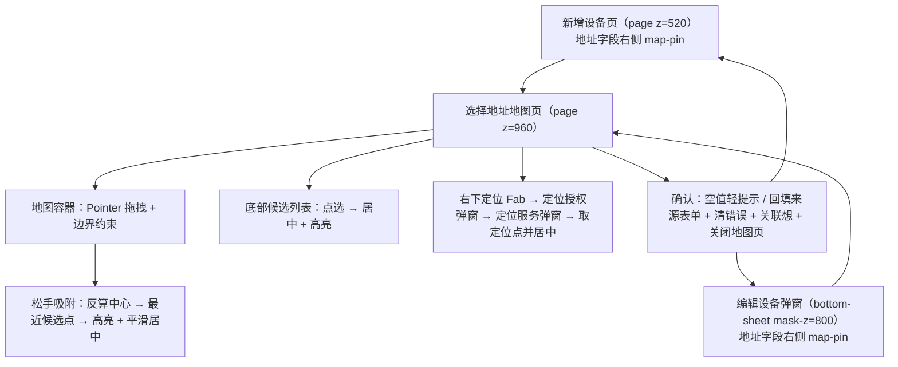

## 需求概述
把商户端「充电设备」新增/编辑时点击地址字段右侧 map-pin 图标后的**选择地址交互**，从当前自造的「列表底部弹窗」改造成与换电端（`swap.html`）**完全一致**的「地图拖拽取点」流程，做到百分百一致（视觉、布局、手势、吸附、定位、确认回填全流程一致）。

## 功能内容
- 点击地址字段右侧地图图标，打开独立的「选择地址」页面（而非底部列表弹窗）。
- 页面结构：顶部导航栏（标题「选择地址」+ 返回取消）；中部为可拖拽的假地图（路网 + 路名 + 候选地址点位），屏幕正中固定一个橙色圆形准星；右下角一个白色方形圆角按钮用于「使用当前定位」；底部为候选地址列表（名称 + 详细地址 + 距离，选中项高亮并在右侧显示对勾），列表下方是通栏「确认」按钮。
- 拖拽交互：按住地图任意位置拖动，地图整体平移（有边界约束）；松手后自动吸附到离屏幕中心最近的一个候选地址点位，选中态切换并平滑归位居中，使准星对准该点。
- 候选列表点选：点击列表任一条目，地图平滑移动使该点居中并高亮。
- 当前定位：首次使用需依次通过「定位授权（不允许 / 允许）」与「定位服务（取消 / 去开启）」两步确认；两步均通过后直接把定位点选中并居中。任一步拒绝则终止本次定位且不改变当前选择。
- 确认与取消：未选择任何地址时点确认，弹出轻提示「请在地图上选择地址」；已选择则把地址回填到来源表单的地址输入框、清除该字段的错误提示、关闭输入联想下拉，并关闭地图页返回（从「新增设备」页进入则回到新增页，从「编辑设备」弹窗进入则回到该弹窗）。
- 入口打开时若地址框已有内容且与某个候选点完全一致，则预先选中该点并居中；否则不预选，地图回到"当前定位"点。

## 视觉与交互要求
- 地图底色为浅绿灰，内部为白色半透明路网（4 横 4 纵）与浅色路名标签；候选点为绿色圆点 + 白底名称标签，选中时圆点变橙色并放大。
- 拖拽时无过渡动画（跟手），松手归位与列表点选时使用平缓的位移缓动（约 0.35s）。
- 除取消旧列表弹窗、新增地图页外，地址字段本身（必填星号、占位文案、清除按钮、地图图标、输入联想）保持现状不变；换电端文件不做任何改动。


## 技术栈
沿用现有项目栈，不引入任何新依赖：
- 单文件 Vue 3（CDN，运行时挂载），商户端位于 `#root-merchant` 作用域
- 样式：内联 Utility 类（UnoCSS runtime）+ 各端独立 `<style id="layer-merchant">` 局部样式块
- 图标：全局 `luci(name, className)` 辅助函数（lucide UMD）
- 文案：`locales/rent/{zh-CN,zh-HK,en,id,th}.json` 五语（zh-CN 为权威源）
- 自检：`scripts/i18n_check.mjs`（键级 MISSING/ORPHAN/PLACEHOLDER/SUFFIX + common 跨目录一致性）

## 实现方案
**核心策略：把 `swap.html` 的门店地址选点整套实现（样式 / DOM / 脚本）一对一移植到 `index.html` 商户端**，只做「作用域收窄」与「数据源替换」两类适配，逻辑结构、类名语义、坐标换算公式、手势行为全部保持原样，从而达成交互百分百一致。

### 关键决策
1. **样式整体移植、仅加作用域前缀**：`swap.html` 的 `.sm-*` 是全局类名，直接搬进 `index.html` 会与另一端（用户端/其它层）潜在冲突，故统一加 `#root-merchant` 前缀并保留原属性值不变（如 `.sm-world`、`.sm-poi`、`.sm-loc-btn` 等一一对应）。视觉数值（尺寸、颜色、圆角、阴影、过渡曲线）逐字照抄，不做"优化"。
2. **候选点数据源替换**：换电端用成都门店点位，商户端充电设备场景改为设备地址候选点（复用现有 5 条 `CD_ADDR_POINTS` 的名称/地址/距离），并**补齐 `lx/ly` 世界层百分比坐标**（参照 swap 的 12–88 区间分布），使吸附与居中算法可直接复用。定位点固定取候选点中的一个（与换电端同样"单一数据源"的做法），避免引入真实地理坐标。
3. **页面层级与返回栈**：新增地图页作为商户端 `<page>` 加入，z 值需高于触发它的一切层级——「新增设备」页为 520、**「编辑设备」是 bottom-sheet（mask-z=800）**，故地图页取 960（高于 900 的既有更多操作弹窗、低于 1000 起的全局浮层）；沿用既有 `navOpen()/navDrop()` 页面栈，保证"从编辑弹窗进入 → 返回后仍停留在该弹窗"。
4. **定位链一并复刻**：换电端的「定位授权（App 级）→ 定位服务（系统级）→ 就绪后自动续跑」两段式确认链是本次交互的一部分，必须一起移植（含"用户主动发起"标记、就绪后自动续跑、任一步拒绝即中止并复位）。商户端现有的 `openVehLocation` 属于寻车定位，与本需求无关，不复用也不改动。
5. **删除旧实现，不留死代码**：移除「选择地址」列表 bottom-sheet 及其专用状态（`cdAddrPickMod` / `cdOpenAddrPick` / `cdPickAddrPoint` 等），并同步清理 setup 返回表；仅保留地址联想所需的状态与函数。

### 性能与可靠性
- 拖拽走 Pointer Events + `setPointerCapture`，`pointermove` 中只做 `translate` 写入（不在拖动中做吸附计算），松手时一次 O(n) 反算最近点（n=5），无高频重排。
- 世界层加 `will-change: transform`；拖动中关闭过渡、非拖动开启过渡，避免动画与手势打架。
- 用 `ResizeObserver` 监听地图容器尺寸，尺寸变化且非拖动中时按当前选中点重新居中（防止页面过渡/字体加载导致准星偏移）；页面关闭时断开观察器，避免内存泄漏。
- 定位弹窗沿用全局 `confirm-dialog` 组件（z=2000 级别），不新增弹窗实现。
- i18n：新增文案五语齐备并保持 `i18n_check` 全 0；沿用 `merchant.chargingDevice` 段（当前 22 键）与换电端已有一致译法，避免跨目录同一中文多种译法（TERM 类问题）。

## 实现注意（防止回归）
- 只改 `index.html`；`swap.html` 是对齐基准，**不得修改**。
- 不改动地址字段的既有形态（`required bare :error` + `ff-box` + 占位 + 右侧 × / map-pin + 联想下拉），只替换 map-pin 的点击目标与随之打开的容器。
- 新增 CSS 必须放进 `#root-merchant` 作用域内的样式块，类名加前缀，避免影响用户端与其它层。
- 地图页内的按钮/点位需保留 `data-od-id`（便于回归验证与后续标注），命名沿用商户端既有 `cd-*` 前缀风格。
- 每次改动后按仓库既有口径自检：内联脚本 `new Function` 语法 0 错、`<div>`/`<page>`/`<bottom-sheet>`/`<kv-card>`/`<kv-row>` 标签配平、`node scripts/i18n_check.mjs` 两目录全 0，并用 Playwright 实机验证 + 截图（本机直连 CDN 会被重置，按既有做法临时把 vue/unocss/lucide 镜像到本地生成 `index.local.html` 验证，验证后删除镜像与副本、关闭临时服务器）。

## 架构设计


## 目录结构（仅列本次受影响文件）
```
e:/test/prototype-app-yadea-rental/
├── index.html                                     # [MODIFY] 商户端样式块 + 新增地图选点页 DOM + 脚本；删除旧列表弹窗与死代码
└── locales/rent/
    ├── zh-CN.json                                 # [MODIFY] 权威源：补充地图选点相关文案（标题/确认/定位授权/定位服务等）
    ├── zh-HK.json                                 # [MODIFY] 同步五语
    ├── en.json                                    # [MODIFY] 同步五语
    ├── id.json                                    # [MODIFY] 同步五语
    └── th.json                                    # [MODIFY] 同步五语

# 只读参考（不得修改）
└── swap.html                                      # 对齐基准：选点页样式（.sm-*）/ DOM / 拖拽吸附与定位链脚本
```

## 关键代码结构（接口级，供实现对齐）
```js
/* 状态（语义与 swap 一一对应，命名加 cd 前缀以贴合商户端设备模块） */
const cdAddrMapOpen = ref(false);        // 地图页开关（接入 <page :open>）
const cdAddrMapTarget = ref('add');      // 'add' 新增页表单 | 'edit' 编辑弹窗表单
const cdAddrMapDraft = ref('');          // 地图页草稿地址（确认后回填）
const cdAddrMapOff = reactive({x:0,y:0});// 世界层位移
const cdAddrMapDragging = ref(false);    // 拖动中（决定是否走过渡动画）
const cdAddrMapBox = ref(null);          // 地图容器引用（尺寸/指针事件）

/* 定位链 */
const cdLocAppAuth = ref(false), cdLocAuth = ref(false);   // App 级 / 系统级
const cdShowLocAppAuth = ref(false), cdShowLocAuth = ref(false);
const cdLocWant = false;                                   // 本次定位由用户主动发起，就绪后自动续跑

/* 关键函数签名 */
function cdOpenAddrMap(which) {}      // 打开地图页：按当前地址命中候选则预选并居中，否则回到定位点
function cdAddrMapDown(e) {}          // pointerdown：记录起点 + setPointerCapture
function cdAddrMapMove(e) {}          // pointermove：位移 + clamp(W/H)
function cdAddrMapUp() {}             // pointerup：反算中心 → 最近候选点 → 高亮 + centerOn
function cdAddrMapCenterOn(p) {}      // x=clamp(W*(1-lx/50),W)，y=clamp(H*(1-ly/50),H)
function cdAddrMapPick(p) {}          // 列表点选 / 定位生效：draft=p.addr + centerOn(p)
function cdUseCurLoc() {}             // 定位 Fab：未授权 → 拉起授权链；就绪 → 直接取定位点
function cdConfirmAddrMap() {}        // 空值轻提示；否则回填目标表单 + 清错误 + 关联想 + 关闭地图页
function cdCloseAddrMap() {}          // 返回取消：关闭地图页（不写回表单）
```


## Agent Extensions

### MCP
- **Playwright MCP Server**
  - Purpose: 在实现完成后做端到端实机验证——分别从「新增设备」页与「编辑设备」弹窗进入地图选点页，跑通拖拽松手吸附、候选列表点选、当前定位两步授权、确认回填与返回取消两条分支。
  - Expected outcome: 得到可复核的实测结论与截图（地图页布局、准星对准选中点、底部列表选中态与对勾、定位两步弹窗、确认后地址框回填且错误提示清除），确保交互与换电端一致。

### SubAgent
- **code-explorer**
  - Purpose: 实现阶段精确核对 `swap.html` 选点页的逐行细节（样式属性值、DOM 层级与 class、脚本函数体、坐标换算与 clamp 边界）以及 `index.html` 商户端页面栈/层级/样式块的准确位置，避免移植过程中漏项或走形。
  - Expected outcome: 输出一份"逐项对照清单"（swap 源 → index 目标），供实现与回归验证逐条打勾。
