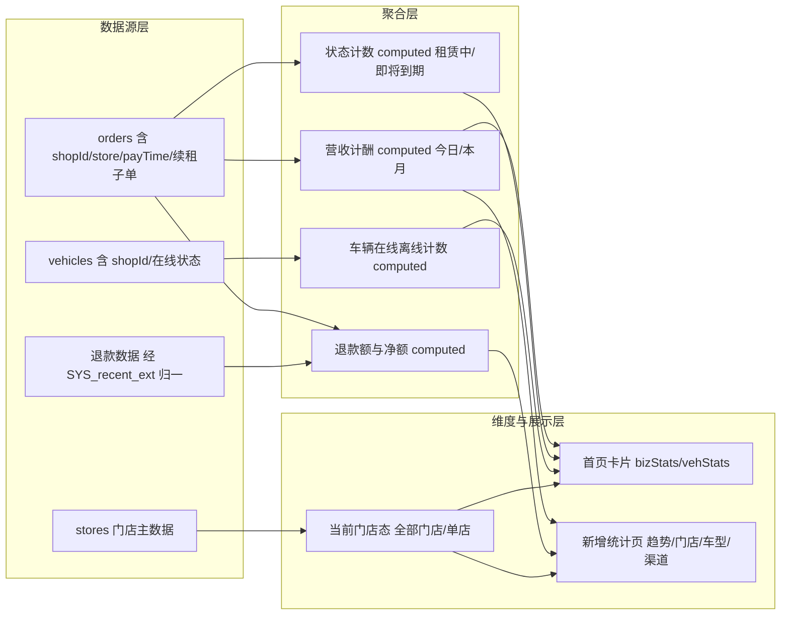

## 产品概述

为租车商户端补齐「统计」能力：把首页两块看板从写死的演示数字改为按真实订单/车辆数据计算，并引入门店维度（全部门店 / 单店）与一个独立统计页（营收趋势、按门店/车型/渠道拆分、续租收入与退款额）。本轮交付物是一份可评审的 Markdown 方案文档（体例对齐仓库既有的 `merchant-home-store-filter-plan.md`，含待确认清单），**不写代码**，用户确认后才进入实施。

## 核心功能

**1. 首页「经营数据」真实统计**

- 今日收款、本月收款：按订单支付时间认收，只计入「已支付且未取消」的订单；续租子单已支付的续租费一并计入。
- 租赁中、即将到期：按订单状态真实计数（对应订单状态「租赁中」「即将到期」）。
- 原写死的 3240 / 28500 / 18 / 8 四个数字全部由数据算出。

**2. 首页「车辆运营」真实统计**

- 在线车辆、离线车辆：按车辆归属门店与在线状态真实计数。
- 卡片仍可点击，跳转车辆列表并带上在线/离线筛选（保持现有交互形态）。

**3. 门店维度切换**

- 首页提供「全部门店 / 单店」切换，切换后门店名、经营数据、车辆运营随之收敛。
- 与既有的门店维度方案文档合并裁决（入口形态、默认态、是否记忆选择、是否与「切换门店」共用状态）。

**4. 新增独立统计页**

- 内容：营收趋势、按门店/车型/渠道的拆分、续租收入、退款额等指标。
- 视觉沿用现有卡片式排版、圆角白卡、既有主题色与分组标题，与首页看板风格一致。

**5. 收款口径（本轮需裁决）**

- 按支付时间认收；仅计「已支付且未取消」；已支付续租费计入。
- 退款额：是「独立指标展示」还是「从收款中净额扣减」——两种都保留意见，方案给出建议口径（独立展示并另给净额）。
- 押金：是否计入「收款/营收」待裁决（不选则只算租金）。
- 门店维度汇总：「全部门店」的展示写法与无归属数据的兜底策略待裁决。

**6. 可评审性**

- 方案内需列明现状事实基线（含行号锚点）、口径公式、逐处改动点清单、建议新增文案、待确认清单、实施步骤与验证方式，确保后续可直接照着实施。

## 视觉与交互效果

- 首页经营数据仍为 2×2 统计卡；车辆运营仍为 2×2 可点卡，在线/离线保留现有主色与警示色分支。
- 门店切换入口沿用现有底部弹窗形态（搜索 + 门店行 + 选中态），不引入新交互范式。
- 统计页为新增全屏子页，进入/返回沿用现有页面栈与过渡；无数据时显示空状态。

## 技术栈与交付物

- **交付物形态**：文档型任务。在仓库根目录新建 `merchant-stats-plan.md`（UTF-8 无 BOM、LF 行尾、结尾换行、2 空格缩进层级），体例对齐既有 `merchant-home-store-filter-plan.md`：文档状态 / 改动范围 / 行号基线 / 现状锚点 / 需求与目标 / 口径定义 / 改动点清单 / 风险与红线 / 待确认清单 / 实施步骤。
- **本轮零代码改动**：`index.html`、`swap.html`、`locales/**` 均不改。文档中的行号只作为锚点引用，不作为改动动作。
- **唯一权威产物不变**：`index.html` 仍是租车端唯一权威源；`swap.html` 本次不涉及。

## 实施方案

以「先固化事实、再定义口径、最后列改动点」的顺序成文，避免方案落在猜测上：

1. **事实基线**：逐条核实并写入文档（已核实，行号基于当前工作区）：

- 首页门店名常量：`const store=computed(()=>({name:'测试门店'}))` 在 `8349`（写死，未接门店主数据）
- 经营数据硬编码：`bizStats` 在 `8350`（今日收款 3240 / 本月收款 28500 / 租赁中 18 / 即将到期 8）
- 车辆运营硬编码：`vehStats` 在 `8351`（在线 42 / 离线 8）
- 车辆运营卡点击：`goHomeVehStat` 在 `8352`（跳车辆 Tab 并置在线/离线筛选）
- 首页模板：经营数据块 `3336-3348`（`can('home.stats.business')`）、车辆运营块 `3349-3409`（`can('home.stats.vehicle')`）、首页空态条件 `3410`
- 已有金额口径 helper（须复用，不得另造第二套）：`orderMainTotal` `6924`、`orderPayTotal` `6925`、`orderPaidAmount` `6926`、`orderUnpaidAmount` `6927`；模板包装 `orderPaidAmountOf` `9301`
- 数据源：`orders`（50 条，已补 `shopId` + `store`（4 家门店全名，按 id 确定性散列）、仅对「已支付且非取消」补 `payTime`）、`vehicles` `6896`（含 `shopId` 与在线状态）、`CZ_ORDERS` `6993`（已补 `shopId`）、退款数据随 `SYS_recent_ext` 归一
- 时间归一：`SYS_recent` `6996`、`SYS_recent_ext` `7000-7001`；调用点 `11011-11012`
- 权限：`ALL_PERM_CODES` `8831-8832` 含 `home.view / home.stats.business / home.stats.vehicle`；`permGroups` `8858-8861`；首页分组 `8918-8919`
- 已暴露到模板的键：`11029-11031`、`11064`（含 `store / bizStats / vehStats / goHomeVehStat / curStore / stores / orderStoreNameOf / orderPaidAmountOf` 等）
- 既有未实施文档：`merchant-home-store-filter-plan.md`（提交 `c3b9191 docs(stats)`，§8 有 7 条待裁决，其中第 4/5 条即「bizStats / vehStats 是否随门店收敛」）
- 数据层前置提交：`ae74835 fix(stats): 统计数据源修正（门店维度/支付时间/续租子单与退款时间归一）`
- 工作区有未提交改动 `M index.html`（上一轮续租子单契约适配 + 金额解析修正），文档不得覆盖或回退，且行号以当前工作区为准

2. **统计口径定义（写入文档，给出公式与建议）**：

- 认收口径：`payTime` 有值、且支付状态非 `pending/processing`、且订单状态非已取消
- 营收构成：租金（`amount`）+ 已支付续租费（`renewSubOrders` 中 `subPayStatus==='已支付'` 且未 `cancelRenew`）+ 押金（**待裁决是否计入**）
- 退款额：作为独立指标；同时给出净额 = 营收 − 退款额（**待裁决展示形态**）
- 计数口径：租赁中 / 即将到期 = 按订单状态计数；在线 / 离线车辆 = 按 `vehicles` 状态计数
- 门店维度：订单按 `shopId`（1..4，与门店主数据下标+1 约定一致）归属；「全部门店」= 不做筛选；沿用既有 `storeNameOf` 约定，不引入第二套门店标识

3. **改动点清单**：逐块列出「现状 → 目标 → 涉及行号/键」，覆盖 `store`、`bizStats`、`vehStats`、`goHomeVehStat`、首页模板两处 `template` 块与空态条件、setup 返回表，以及新增统计页的入口、权限码归属、区块与指标。

4. **合并裁决**：明确本方案与 `merchant-home-store-filter-plan.md` 的关系（合并为一份 / 保持两份并交叉引用），并给出对既有 §8 七条待裁决项的处置建议（本轮不改动该文档）。

5. **可实施性**：待确认清单 + 实施步骤（模板 → 脚本 → 暴露 → 五语文案 → 验收走查）+ 验证口径。

## 实施说明（执行细节）

- **性能**：首页与统计页的聚合统一用 `computed` 做**单次 O(n) 遍历**（n 为订单/车辆条数，量级 10^2），避免在模板里对每张卡片重复调用计算函数，也避免「订单 × 渠道」双重遍历；维度切换仅改变筛选条件，不重建数据源。
- **口径唯一性**：金额一律复用 `orderMainTotal / orderPayTotal / orderPaidAmount` 系列，禁止在展示层用 `parseRp` 或字符串拼接二次加总（历史上出现过押金混入租金、与续租金额重复计费的问题）。
- **组件复用**：门店选择只走既有 `bottom-sheet` + 搜索 + 门店行形态；新增统计页只用既有 `page` / `nav-bar` / `kv-card` / `empty-state`，不新写手写弹窗或全屏壳。
- **i18n 边界**：本轮**不写** `locales/rent/*.json`——在 HTML 无引用的前提下先加词条会令 `node scripts/i18n_check.mjs` 报 ORPHAN。方案内只以表格登记建议词条（key + 中文），实施时再按 `zh-CN` 单向同步 `zh-HK/en/id/th` 并跑校验全绿。
- **权限边界**：新增统计页是否复用 `home.stats.business` 或新增权限码必须列入待确认清单；若新增，需同步 `ALL_PERM_CODES` 与 `permGroups`，否则会出现「无权限空态」误判。
- **爆炸半径控制**：文档只读不改；不触碰 `swap.html`；不改动既有未提交的 `index.html` 改动；不重命名或迁移既有 helper。
- **文档自检**：文中每个行号锚点须能用 grep 在 `index.html` 中命中；Markdown 表格列数一致、代码块闭合；交付后确认 `git status` 仅新增文档（无代码文件被改动）。

## 系统结构



## 目录结构

```
merchant-stats-plan.md            # [NEW] 本次唯一交付物。统计需求方案文档。内容依次为：文档状态（仅方案·未实施）与改动范围（仅 index.html 商户端，用户端与 swap.html 零改动）、行号基线说明；§1 需求与目标 + 非目标；§2 现状事实基线（逐条锚点表：store 8349 / bizStats 8350 / vehStats 8351 / goHomeVehStat 8352 / 首页模板 3336-3348 与 3349-3409 与空态 3410 / 金额 helper 6924-6927 与 9301 / 数据源 orders、vehicles 6896、CZ_ORDERS 6993、SYS_recent 6996、SYS_recent_ext 7000-7001、调用点 11011-11012 / 权限 8831-8832、8858-8861、8918-8919 / setup 返回表 11029-11031、11064）；§3 统计口径定义（认收口径、营收构成、退款额与净额、计数口径、门店归属约定，每项给出公式与建议值，并标注哪些属待裁决）；§4 首页改动点清单（store / bizStats / vehStats / goHomeVehStat / 两处 template 块 / 空态条件 / setup 返回表，逐条写「现状 → 目标 → 锚点」）；§5 新增统计页规划（入口位置、权限码归属建议、页面区块与指标、空态、数据来源与聚合方式）；§6 与 merchant-home-store-filter-plan.md 的合并裁决（含对既有 §8 七条待裁决项的处置建议）；§7 建议新增文案登记表（建议 key + 中文值，注明实施时才写入 locales 五语）；§8 红线与风险；§9 待确认清单；§10 实施步骤与验证口径（静态自检 + Playwright 实机判据）。
merchant-home-store-filter-plan.md # [参考·本轮不改] 既有门店维度方案；本方案需在 §6 明确与其合并或并行的关系，本轮不修改该文件。
index.html                         # [参考·本轮不改] 行号锚点来源；当前工作区含未提交的续租契约适配改动，方案行号以此为准，文档不覆盖不回退。
```

## 关键结构说明

文档中「统计口径定义」章节建议固化为如下口径表达式（文字描述，不写实现代码），供实施阶段与用户逐条勾选：

- 认收判定：`payTime` 非空 且 支付状态不属于「待支付/处理中」 且 订单状态不属于「已取消」
- 营收（主口径）：主订单租金 + 主订单押金（待裁决）+ 已支付且未撤销的续租子单续租费
- 退款额：独立指标；净额 = 营收 − 退款额
- 期间归属：今日 = 当日 00:00 至当前；本月 = 当月 1 日 00:00 至当前；归属字段为 `payTime`
- 门店维度：订单归属字段 `shopId`（1..4）；「全部门店」不筛选；车辆归属同用 `shopId`

## Agent Extensions

### SubAgent

- **code-explorer**
- Purpose: 在 `index.html`（单文件、超万行）中批量复核方案文档内引用的全部行号锚点与字段（`store` / `bizStats` / `vehStats` / `goHomeVehStat` / 首页两处 template 块 / 空态条件 / `orderMainTotal` 系列 / `orders` 的 `shopId`、`store`、`payTime`、`renewSubOrders` / `vehicles` 的 `shopId` 与在线状态 / `CZ_ORDERS` / `SYS_recent(_ext)` / 权限码与 setup 返回表），确认每条锚点均能在当前工作区命中且语义一致。
- Expected outcome: 输出逐条「锚点 → 是否命中 → 实际内容摘要」的核对结果；对偏移或失效的行号给出修正值，使文档的现状事实基线全部可 grep 验证，避免实施阶段因行号漂移返工。