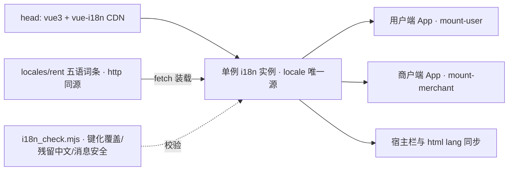

# 租车系统真实接入 i18n · 方案与执行计划（v2）

> 标识：`rent-i18n-runtime-integration`
> 修订：v2（2026-10-14）——按用户要求**移除「file 直接打开的可见降级提示」**：原型后续用于部署演示，本地开发一律起 http 服务访问。词条加载异常只做控制台报错，不新增任何降级 UI。

## 一、产品概述

`index.html` 是雅迪租车系统的原型（用户端与商户端合一的单文件 in-DOM 模板，CDN Vue3 + UnoCSS 运行时，零构建）。当前虽已有语言状态与语言选择入口，但切换语言只改状态、界面文案仍是硬编码中文。本次把 i18n 真实接入：浏览器内切换语言，整个界面（用户端与商户端）立即按词条翻译。

## 二、核心功能

- **真实语言切换**：简体中文、繁体中文（香港）、English、Bahasa Indonesia、ไทย 共 5 种，默认简体中文；登录页语言入口与设置页语言列表补齐泰语。
- **双端同步**：同一语言状态驱动用户端与商户端，任一端切换另一端同步；切换即时生效（无需刷新），不重挂载、不丢当前页面与返回栈。
- **词条唯一来源**：界面文案全部由词条驱动（页面可见文本、按钮与标签、输入框占位、提示与弹窗、空状态、状态名、单位与规则长文本、toast）。
- **动态文案本地化**：带变量的句子（租赁时长、金额、剩余时间、版本号等）按占位符取值，不在代码里拼接中文。
- **缺词降级**：词条缺失时回落简体中文，不抛错、不中断渲染。
- **访问方式（v2 修订）**：词条通过 **http 同源** `fetch` 装载；**部署演示与本地开发都走 http**（本地用 `python -m http.server`），因此**不做 file:// 的降级提示 UI**。装载异常时仅在控制台输出明确错误（含排查提示），页面继续按可用内容渲染。
- **范围边界**：演示假数据（示例订单、示例电池等）保持原样不翻译；换电端与两份 SOP 手册本次不改。
- **视觉表现**：结构、配色、排版、交互与现状完全一致，仅文案随语言变化；语言列表新增泰语项；长文案（泰语、印尼语）不溢出、不截断。

## 三、技术栈

- 运行时：沿用现有 CDN Vue 3 全局生产构建 + UnoCSS 运行时，不引入打包器 / package.json / 构建步骤。
- 新增依赖：`vue-i18n@9` 全局生产构建（`vue-i18n.global.prod.js`），与现有 Vue 标签同款：jsdelivr 主源 + `onerror` 切 unpkg 兜底。
- 词条源：`locales/rent/{zh-CN,zh-HK,en,id,th}.json`（1183 键，zh-CN 为唯一权威源），运行时 `fetch` 装载，不在 HTML 内联副本。
- **部署约束（v2 新增）**：`locales/rent/*.json` 必须与 `index.html` **同源同路径**一起发布（产物目录保持 `index.html` + `locales/rent/` 的相对结构）；演示环境直接静态托管即可。
- 校验与验证：扩展 `scripts/i18n_check.mjs`；新增 `scripts/i18n_keyize.mjs`；用 `python -m http.server` + Playwright 做真机验证。

## 四、实现方式

### 关键决策

1. **单例 i18n、双端共享**：在 `mountUser`/`mountMerchant` 之前创建 i18n 实例，分别 `app.use(i18n)`；`i18n.global.locale` 成为全站唯一语言源。两端原 `appLang` ref 改为桥接 computed（保留模板现有写法，改动最小），消除两端状态漂移。
2. **模式配置**：`legacy:false` + `globalInjection:true` + `fallbackLocale:'zh-CN'` + `missingWarn:false` / `fallbackWarn:false`。
3. **装载与首屏（v2 修订）**：`mount` 前先 `await` 装载 zh-CN 词条——未挂载时显示原生中文 DOM，无闪烁；其余 4 语在首次切换时按需 `fetch` 并缓存。**装载失败不再拦截挂载、也不做可见提示**：`console.error('[i18n] 词条加载失败 …')` 记录语言、URL、状态码，并附「请通过 http 访问（本地：python -m http.server），并确保 locales/rent 与 index.html 同源部署」的排查提示，然后继续挂载，保证部署环境异常时仍可看到页面骨架与其他正常内容。
4. **模板键化写法（新规范核心）**：静态文本 `{{ $t('key') }}`；静态属性（title / placeholder / alt / aria-label / 组件纯文本 prop）改绑定表达式 `:title="$t('key')"`；JS 字符串组件模板（`registerSheetKit` 内单引号模板串）用双引号别名 `{{ tr("key") }}`（`tr` 挂到 `globalProperties`）规避 `\'` 转义；动态拼接统一 `t('key',{n})`，占位符沿用 vue-i18n `{n}`；不键化 `demo.*`、品牌专名（YADEA、2C2P）、货币码、VIN、电话号码。
5. **半自动加速 + 人工清尾**：codemod 做「中文值 → key」反查（实测 434 段源码文本约 347 段精确命中；值锚定歧义仅 3 条：暂无设备 / 充电订单 / 结束订单，走显式白名单），再人工处理 87 段未命中、属性、JS 拼接与动态插值。codemod 必须 dry-run 出报告、仅整段精确匹配、跳过含插值或子标签节点、幂等可重跑，逐页分批落盘。
6. **消息安全预检**：locale 值里的 ASCII `|`（复数分隔）、`@:`（linked message）、裸 `{`（插值）会改变消息编译语义，必须先扫描处理。
7. **JSON 点路径直用**：嵌套 JSON + 点路径 key（如 `user.orders.billingRules.3`）与 vue-i18n 解析天然一致，`setLocaleMessage` 整对象装载，无需扁平化。

### 性能与可靠性

- 词条总量约 370KB（5 语），首屏只强依赖 zh-CN（约 53KB），其余按需装载；切换语言只写 1 次 `locale`，触发双端各一次重渲染。
- 缺词回落 zh-CN 不抛错；切换语言不重挂载，保留快照式页面栈与滚动位置。
- 逐页分批验证，避免一次性重写模板区导致标签失衡与不可回溯。

## 五、架构设计



## 六、目录结构与改动点

```
prototype-app-yadea-rental/
├── index.html                          # [MODIFY] 唯一权威产物。head 新增 vue-i18n CDN（含兜底）；模板区按页键化；内联脚本区新增 i18n 引导（单例实例、词条 fetch 装载、失败仅控制台报错、语言切换、宿主栏与 html lang 同步）、双端 app.use(i18n)、appLang 改桥接 computed、langOptions 补 th、去除商户端 appLangLabel 硬编码、rulesOf 等长文案改词条取值
├── locales/rent/zh-CN.json             # [MODIFY] 权威源：为未命中文案补键（先写中文源），沿用 common.* / user.* / merchant.* 命名空间
├── locales/rent/{zh-HK,en,id,th}.json  # [MODIFY] 同步新增键译文
├── scripts/i18n_keyize.mjs             # [NEW] 半自动键化脚本：中文值→key 反查索引、歧义白名单、dry-run 报告、分批幂等重写 + 消息安全预检
├── scripts/i18n_check.mjs              # [MODIFY] 新增三段校验：t/tr 键使用与词条比对、模板区残留中文扫描、消息编译安全字符扫描
├── AGENTS.md                           # [MODIFY] §1 允许 HTML 使用 t()；§5 重写为键化写法与红线（含「词条须与 index.html 同源 http 部署」）；§6 新增五语切换冒烟与残留中文自检
├── i18n-key-naming.md                  # [MODIFY] 新增页面级键命名决策与 common 归并口径
├── i18n-cross-drift.md                 # [MODIFY] 新增键若与换电端同中文，按中文值锚定复核并登记
└── docs/                               # [不改] 两份 SOP 手册保持现状，仅在结论中说明配图与新文案差异
```

## 七、关键代码结构

```js
/* index.html 内联脚本：位于 mountUser/mountMerchant 之前 */
const I18N_LANGS = ['zh-CN','zh-HK','en','id','th'];
const i18n = VueI18n.createI18n({ legacy:false, globalInjection:true, locale:'zh-CN',
  fallbackLocale:'zh-CN', messages:{}, missingWarn:false, fallbackWarn:false });
async function loadLocale(lang){                 /* 幂等：已装载即返回 */
  if (i18n.global.availableLocales.indexOf(lang) !== -1) return;
  const res = await fetch('locales/rent/' + lang + '.json', { cache:'no-store' });
  if (!res.ok) throw new Error('i18n ' + lang + ' ' + res.status);
  i18n.global.setLocaleMessage(lang, await res.json());
}
async function setLang(lang){
  await loadLocale(lang);                        /* v2：失败仅 console.error，不阻塞交互 */
  i18n.global.locale.value = lang;
  document.documentElement.lang = lang;
  hostSyncLangText();
}
/* 两端 setup 内：语言状态唯一源改为 i18n，模板写法保持不变 */
const appLang = computed({ get: function(){ return i18n.global.locale.value },
                           set: function(v){ setLang(v) } });
const langOptions = [{id:'zh-CN',label:'简体中文'},{id:'zh-HK',label:'繁體中文（中國香港）'},
  {id:'en',label:'English'},{id:'id',label:'Bahasa Indonesia'},{id:'th',label:'ไทย'}];
```

```js
/* scripts/i18n_check.mjs 新增（仅对 rent/ 生效，扫描对象 index.html） */
function scanTKeys(html)         /* Set：模板与 JS 中 $t('k') 与 tr("k") 用到的 key */
function scanResidualHan(html)   /* { count, samples }：剔除 script/style/注释/demo 段后的中文残留 */
function scanMessageSafety(flat) /* { pluralPipe:[], linkedAt:[], bareBrace:[] }：消息编译安全 */
```

## 八、执行计划（对应 8 个待办）

1. **i18n-infra**：Context7 核对 vue-i18n v9 全局构建 API → 接入 CDN 与单例实例、词条 fetch 装载、双端 `app.use`、`appLang` 桥接、`langOptions` 补 th、默认 zh-CN、**失败仅控制台报错（v2）**。
2. **i18n-inventory**：code-explorer 盘点模板区与脚本区未键化中文（文本、属性、组件 prop、JS 拼接、toast），产出「既有 key 映射」与「需补键」清单。
3. **i18n-codemod**：新增 `scripts/i18n_keyize.mjs`（反查索引、3 条歧义白名单、dry-run 报告、分批幂等重写、消息安全预检）。
4. **i18n-user-dom**：用户端模板键化（登录实名、首页、选择门店与方案、订单确认与规则卡、支付、订单列表与详情、钱包、我的与设置）。
5. **i18n-merchant-dom**：商户端模板键化（首页与经营数据、四类订单、车辆/电池管理、套餐与充值配置、订单配置、账号职位权限、告警客服、个人中心）。
6. **i18n-js-layer**：JS 层键化与补键（toast、状态映射、确认弹窗、computed 标签、rulesOf 长规则、动态插值），五语词条同步。
7. **i18n-guard**：修订 `AGENTS.md` §1/§5/§6 并扩展 `i18n_check.mjs`（键化覆盖、残留中文、消息安全），跑通全量校验。
8. **i18n-verify**：Playwright 五语逐页冒烟与截图 + code-review 对照规范复核，给出验收结论。

## 九、执行注意

- **分批落盘**：模板区按页面拆批，每批跑 §6 自检（内联脚本 `new Function` 编译、标签配平）+ 浏览器冒烟；禁止一次性重写整段模板。
- **残留中文扫描必须用 Node**：本机 shell 的 grep 对 CJK 匹配实测返回 0。
- **提交卫生**：只 `git add` 本次改动文件，禁用 `git add -A`。
- **术语流程**：新增中文文案先写 zh-CN 源再补四语；禁止机翻入库、禁止中文常驻译文；跨目录同句中文译法须一致（TERM 硬校验）。
- **易踩坑位**：静态属性与绑定表达式不可混用；组件模板串内引号需转义或走 `tr` 别名；UnoCSS 按需异步生成，验证需等约 1 秒；生产构建下不可依赖 `app._instance` 判断挂载。
- **验证方式（v2）**：一律 http 访问——`python -m http.server 8139` → `http://127.0.0.1:8139/index.html`。
- **本次不做**：语言持久化（不写 localStorage）、不按浏览器语言自动判定、不改换电端与 SOP 手册、不翻译演示假数据、**不做 file:// 降级提示与离线兜底（v2 移除）**。

## 十、修订记录

| 版本 | 日期 | 修订内容 |
| --- | --- | --- |
| v1 | 2026-10-14 | 首版：目标原型可切语言、范围 index.html 双端、路线 B 全量 t(key) 键化、5 语言默认中文 |
| v2 | 2026-10-14 | 移除「file 直接打开的可见降级提示」：词条一律 http 同源装载，失败仅控制台报错；新增部署约束（`locales/rent` 与 `index.html` 同源发布）与 http 验证口径 |